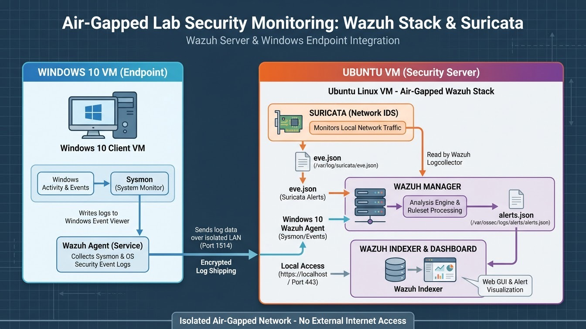
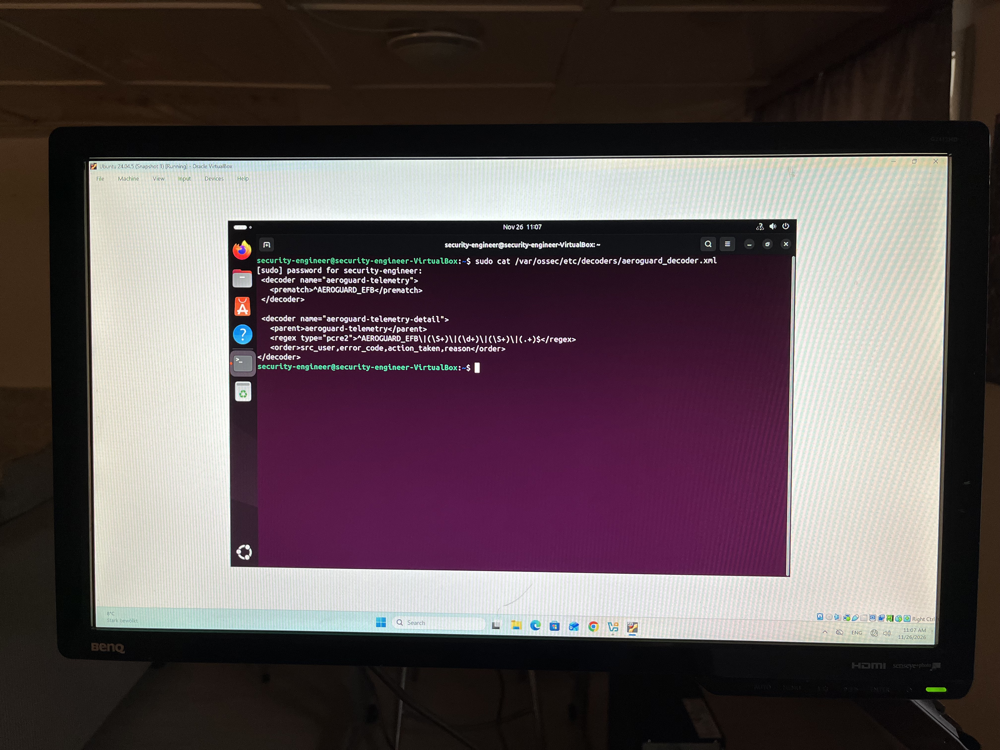
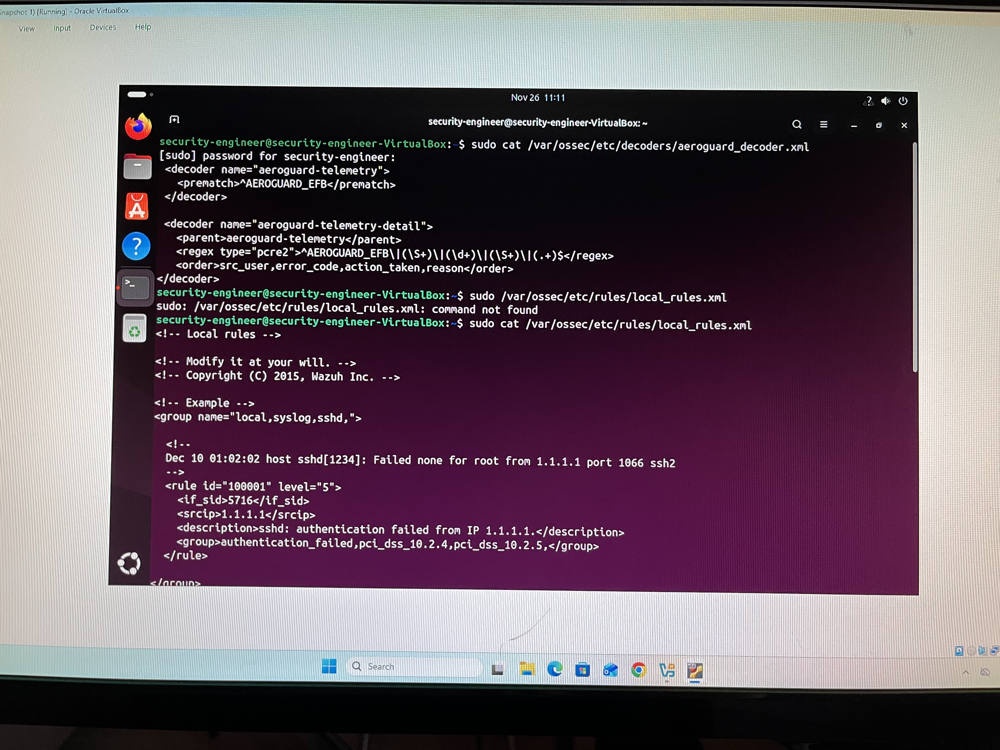

# AeroGuard SIEM Lab: End-to-End Threat Detection Engineering

## Overview
This lab implements an air-gapped SIEM architecture, isolating detection capabilities from external threats. Telemetry flows from a hardened Windows 10 endpoint running Sysmon, feeding encrypted logs to an Ubuntu server running the Wazuh Manager and Suricata IDS. This setup validates end-to-end detection engineering by parsing proprietary aviation telemetry and triggering verified security alerts.

## Architecture Topology


*Air-gapped network flow from the Windows 10 endpoint to the Ubuntu Wazuh server.*

## Telemetry Pipeline


![Local2]

* **Endpoint Collection (Windows 10 VM):** The Wazuh agent on the Windows 10 virtual machine collects Sysmon and Windows Security Event logs, shipping them encrypted over TCP/1514 to the Ubuntu server.
* **Network Monitoring (Ubuntu Server VM):** Suricata monitors local virtual network traffic on the Ubuntu host, writing alerts to `eve.json`, which the Wazuh Logcollector ingests for correlation.
* **Custom Decoding & Correlation:** A custom XML decoder (`config/aeroguard_decoder.xml`) parses proprietary `AEROGUARD_EFB` telemetry streams into structured fields (`src_user`, `error_code`, `action_taken`, `reason`), allowing correlation rules (`config/local_rules.xml`) to trigger alerts on authentication anomalies (`rule.id: 100100`, `rule.level: 7`, MITRE `T1078`).

## Key Takeaways

* **Protocol Familiarity:** Mastery over custom XML decoding and PCRE2 regex optimisation for non-standard telemetry.
* **Defense-in-Depth Validation:** Using controlled, non-destructive log tests and threat emulation to verify end-to-end detection logic.
* **Operational Hardening:** Balancing strict endpoint security posture with localised, process-scoped execution policies.

## Repository Structure

```text
aeroguard-siem-lab/
├── architecture/
│   └── diagram.jpg            # Air-gapped VM network topology
├── config/
│   ├── aeroguard_decoder.xml  # Custom telemetry decoders
│   └── local_rules.xml        # Correlation and alerting rules
├── scripts/
│   └── sim-test.ps1           # PowerShell log test & threat emulation script
├── validation/
│   └── figure_2_alert.jpg     # Wazuh Discover dashboard hit
└── README.md                  # Project overview and runbook

```

Deployment Runbook
To replicate this detection pipeline on an existing Wazuh Manager:
1. Copy config/aeroguard_decoder.xml to /var/ossec/etc/decoders/.
2. Copy config/local_rules.xml to /var/ossec/etc/rules/.
3. Validate the configuration syntax and restart the manager:


sudo /var/ossec/bin/wazuh-analysisd -t
sudo systemctl restart wazuh-manager

Validation & Proof of Work
Step 1: Controlled Log Test & Telemetry Generation (Windows 10 VM)
To safely validate the detection pipeline without introducing live malware into the lab, scripts/sim-test.ps1 (C:\Tools\sim-test.ps1) runs a controlled log test that emits simulated aviation telemetry:

Write-Output "AEROGUARD_EFB|admin|403|AUTH_FAIL|SIMULATED THREAT"


When Windows blocked script execution under default security settings (PSSecurityException), a process-scoped bypass was applied to run the log test safely while preserving the Windows 10 VM's persistent security baseline:

Set-ExecutionPolicy -ExecutionPolicy Bypass -Scope Process

Step 2: SIEM Ingestion & Rule Correlation (Ubuntu Server VM / Wazuh)
Following the simulated log test, real-time detection was verified inside the Wazuh Discover dashboard (aeroguard query) hosted on the Ubuntu VM. The alert matches rule 100100 (rule.level: 7, groups aeroguard, telemetry, MITRE T1078) with parsed fields data.src_user: admin, data.error_code: 403, data.action_taken: AUTH_FAIL, and data.reason: SIMULATED THREAT, confirming end-to-end decoding and correlation.
